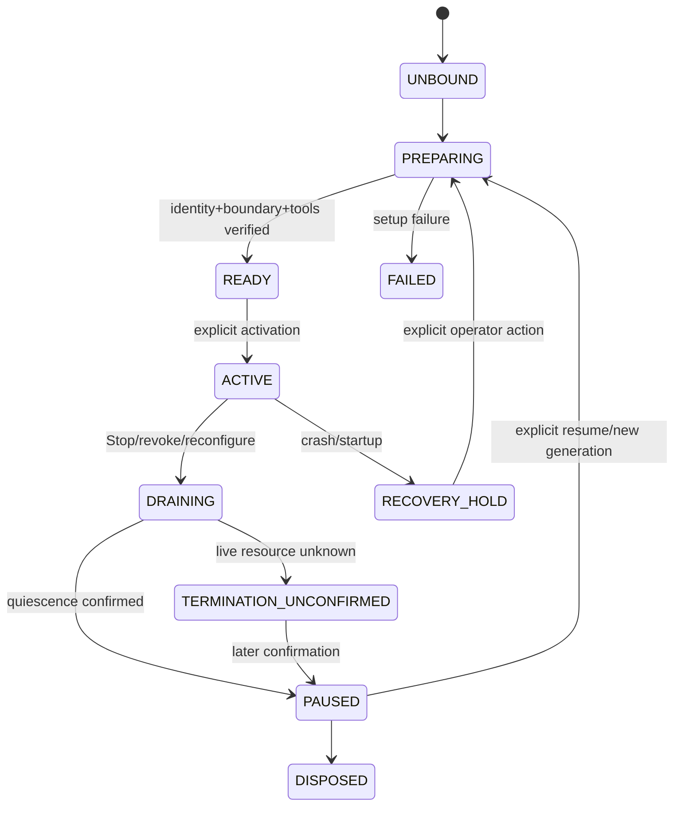
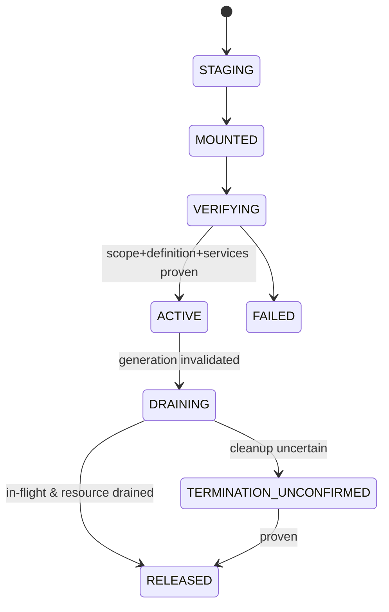
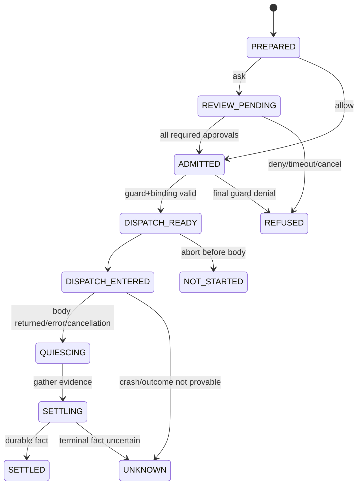

# 六、四套关键状态机

> **状态：DRAFT DESIGN / DOCUMENTS ONLY / DO NOT MERGE WITHOUT OWNER REVIEW。** 本目录记录下一版本的拟议架构，不是现行实施计划、权限裁决、生产配置或发布保证。批准本 PR 不等于授权开发或变更当前 Authority。
> 
> **技术基线**：DSH `dsh-v0.2.2-rc.3`（tag commit `38a6a5c965aa99ab525161efb7cc5cf1fe62fced`，2026-11-13）；Team 文档基线 `master@6361185d878ab2617193d51dd419e6dfe521a2ad`。当前 Team 实际仍使用 DSH `0.2.0-rc.2@639ed015397290b3745d163aafe02ffee4aa3f84`，新版接口未在 Team 上集成或验收。
> 
> **发布边界**：仅在 PR #758 被合并、另行完成既定 v0.1.6 受限内部试用版冻结后，才规划下一版本的主机升级与代码迁移；此提案不更改 `AGENTS.md`、`docs/ROUTER_RULES.md`、`dev/engineering/current-authority.json`、任何 active plan、产品代码、测试基线或 PR #758。

所有状态机均为**设计目标**，不是将当前不同模块的枚举机械合并。它们允许有临时技术状态，但状态归属、拒绝语义与事故恢复不可含糊；具体异常对应 [第 7 节](./07-SETTLEMENT-RECOVERY.md)。

## 1. Agent Execution Scope（Team Domain 负责身份；绑定器负责环境）

- Leader/Officer/Member 都拥有受控 I/O scope；根 Host Control 服务不因此降级为 Member 子进程。
- READY/ACTIVE 前不能启用未验证的工具 Binding。Stop 先提交持久控制事实，再拒新执行、请求排空和杀进程。
- 冷启动默认进入 `RECOVERY_HOLD`（或等价停止态），**不得自动 Officer wake、Agent replay、续跑旧工具**；恢复须按用户已裁决的 Leader/有权操作员流程进行。

## 2. Tool Binding（NativeBindingAssembler）

- 单个 Agent Scope × ToolName 的唯一可执行 Binding；DSH Registry 为 ToolDefinition 权威。所有来源变化/Provider 缺口在 ACTIVE 前被拒绝。
- DRAINING 期间 Guard/mask 不得先卸掉而暴露 inherited tool；不可在原 BindingReceipt 中原地换来源、政策或服务。
- 被认可的 A/B 最后窗口是受信运行时环境责任，保留已有变更监控，不作新的 Core 安全保证。

## 3. ExecutionAttempt（DSH Pipeline + Team 事实关联）

- `DISPATCH_ENTERED` 不等于 Body 已开始；区别 `ABORTED_BEFORE_DISPATCH` 与 Body 已调用后 `ABORTED`，且即使后者也不表明副作用被撤销。
- Grant 消费与执行完成是分立事件；已消费但 Body 未进入/无法确认的情形不可被自动重试。
- Settlement 按 ExecutionId 幂等；`unknown` 为保守真实记录，可追加后续证据，但不能悄悄覆盖。

## 4. OS Execution Domain（Process/Terminal Provider）
```text
UNALLOCATED → PREFLIGHTED → SPAWN_PENDING → RUNNING(fixed boundary/revision)
  → STOP_REQUESTED or PROCESS_EXITED → QUIESCING
  ├── TERMINATED_CONFIRMED → RELEASED
  └── TERMINATION_UNCONFIRMED → later reconciliation
```
- 进程租约至少绑定 AgentInstance、ToolBinding、PolicyRevision、Backend、PID/启动 identity、LeaseId、ProfileDigest。
- 长寿命 Bash/PTC/MCP/LSP 对权限代际检查；旧域不就地加宽。收紧/Stop 时禁止新命令，终止/排空旧域；失败不能表述为已确认停止。
- Provider 负责真实 PID/pty/子孙进程 quiescence；ExecutionSettlement 只消费证明，不凭 Host 返回值推定真实已死。

## 5. 跨状态机一致性
`Scope.ACTIVE ⇒ relevant Binding.ACTIVE`；新 Body 不能从 `Scope.PAUSED/RECOVERY_HOLD` 产生；`Binding.RELEASED` 以前所需 Guard/mask 仍有效；`OS Domain.RELEASED` 需要 `TERMINATED_CONFIRMED`；`Execution.SETTLED` 不等于无副作用。状态机不额外创造审批权限。详见 [第 11 节](./11-INVARIANTS.md)。

---

**文档导航**：[总索引](./README.md) · [一、总体架构裁决](./01-ARCHITECTURAL-DECISIONS.md) · [二、总体模块架构与权威归属](./02-MODULES-AND-AUTHORITY.md) · [三、最新 DSH 下的一次完整工具调用](./03-EXECUTION-FLOW.md) · [四、统一数据模型与信息流](./04-CONTRACTS-AND-DATAFLOW.md) · [五、各工具族如何通过同一架构接入](./05-TOOL-ADOPTION.md) · [六、四套关键状态机](./06-STATE-MACHINES.md) · [七、审批、执行与持久化之间的权威状态管理](./07-SETTLEMENT-RECOVERY.md) · [八、现有代码的重构与退役方案](./08-LEGACY-MIGRATION.md) · [九、基础设施 Fork 边界](./09-INFRASTRUCTURE-FORKS.md) · [十、迁移实施顺序与验收门禁](./10-IMPLEMENTATION-GATES.md) · [十一、统一执行架构不变量](./11-INVARIANTS.md)
